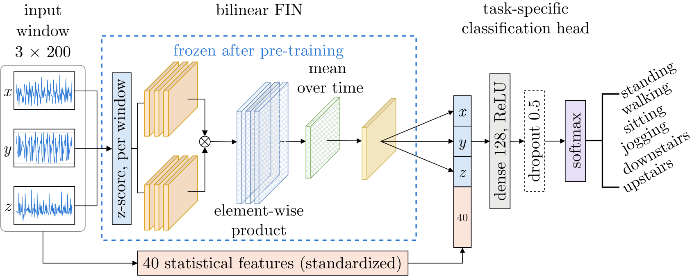

# ARSU Labs - Bilinear Feature Imitating Networks for Human Activity Recognition

This is the code of the paper "Cross Dataset Generalization with Feature Imitating Networks for Human Activity
Recognition" (Azamat Amanbay, Sungat Serikbay, Sari Saba-Sadiya).

---

## 1. Abstract

Machine learning applications for wearable intelligence, such
as human activity recognition, are hindered by low generalization to unseen
subjects, and large variability across hardware and configurations.
In this work we demonstrate that Feature Imitating Networks outperform
competing baselines not only under the standard train/test split, but also
in generalization to unseen subjects under extreme data scarcity conditions,
as well as to other datasets entirely. Overall, these results highlight
that Feature Imitating Networks can be a promising alternative direction
for real-world wearable applications, which is increasingly dominated by
large, task-agnostic foundation models.

---
## 2. Architecture

<p align="center">
  
  <br>
  <em>Figure 1: Architecture of bilinear FIN. Each axis of a 3 × 200 window is z-scored
and passed one at a time through the bilinear FIN: two linear convolutions, their
element-wise product and its mean over time and a dense layer. The three axis
embeddings are concatenated with the 40 standardized statistical features and
classified by a dense layer head with dropout and a softmax over the activities. </em>
</p>

---

## 3. Prerequisite

```bash
python -m venv .venv
.venv\Scripts\activate          # Linux/macOS: source .venv/bin/activate
pip install -r requirements.txt
```
### 3.1 Datasets
We focus on two common datasets **WISDM v1.1** and **MotionSense** as they use similar labels, allowing us to directly compare generalization performance across
datasets. For each dataset, we use a subject-level split, and 10-second windows
with 50% overlap. We always ensure that each window contains data from a 
single activity at a time.

---

## 4. Experiments

### 4.1 Data Scarcity

The models were trained on the windows of 7 users from WISDM and tested on the 27 unseen users of the same dataset,
over 5 seeds for 150 epochs.

Run two notebooks from `data-scarcity/`:

- `data_scarcity.ipynb`: neural models and the accuracy curves
- `baselines_7_users.ipynb`: classical models

### 4.2 Cross-dataset

The models were trained on one dataset and tested on the other, over 5 seeds for 60 epochs:

- **WISDM users 1–26 → all 24 MotionSense users**
- **MotionSense users 1–18 → all 36 WISDM users**

Neural models:

```bash
python cross-dataset/cross_dataset.py w2m      # WISDM -> MotionSense
python cross-dataset/cross_dataset.py m2w      # MotionSense -> WISDM
```

Classical models: the scripts in `baseline/cross-dataset/wisdm-to-motionsense/` and
`baseline/cross-dataset/motionsense-to-wisdm/`.
